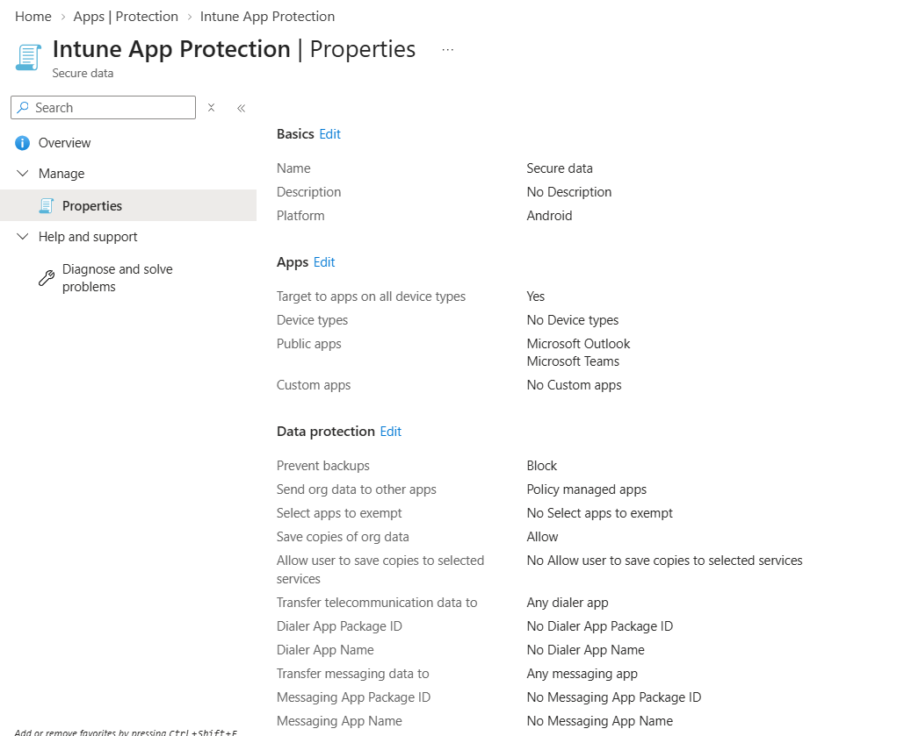
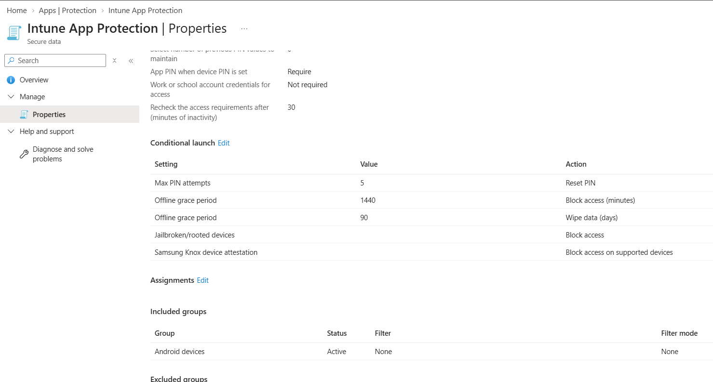
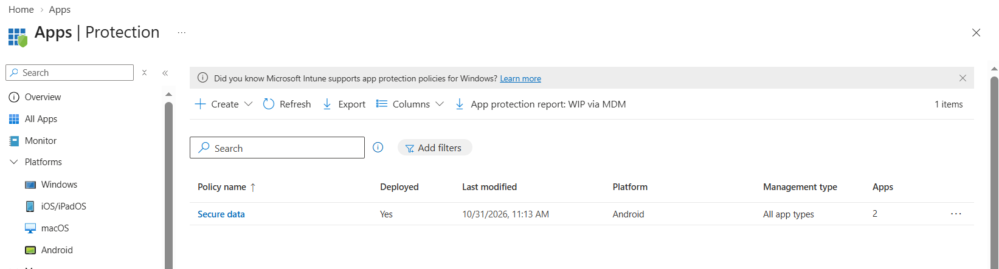

# Android Enterprise – App Protection Policy

<badge color="success">Implemented and validated</badge>

## Project Overview

This project demonstrates the configuration and deployment of an Android App Protection Policy using Microsoft Intune to protect organizational data within supported mobile applications.

## Lab Environment

| Component | Configuration |
|---|---|
| Platform | Android |
| Management | Microsoft Intune |
| Enrollment | Personally Owned Work Profile |
| Policy type | App Protection Policy |
| Applications | Shopify and Etsy |

## Configuration

An Android App Protection Policy was created in Microsoft Intune.

The configured data protection settings are documented in the screenshots below.

## Application Assignment

The policy assignment was configured for the intended application users or groups.

## Deployment and Validation

Microsoft Intune reported a successful assignment status (**Succeeded**).

## Evidence

### App Protection Configuration – Part 1

### App Protection Configuration – Part 2

### Assignment Status

*Screenshots captured from a personal Microsoft Intune lab tenant. Sensitive information has been redacted for privacy.*
