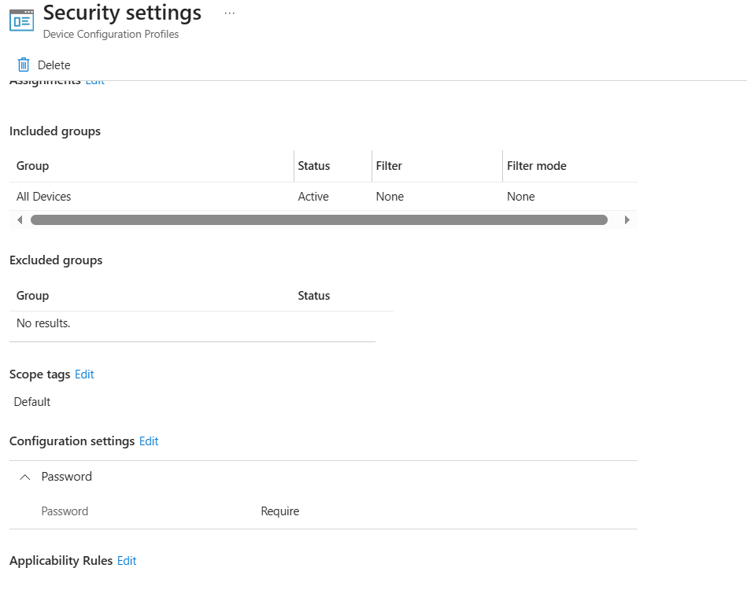
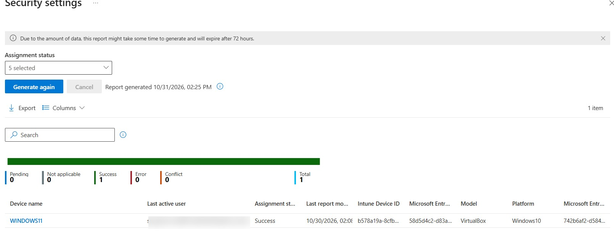

# Android Enterprise – Device Restrictions Policy

<badge color="success">Implemented and validated</badge>

## Project Overview

This project demonstrates the configuration and deployment of an Android Enterprise Device Restrictions policy using Microsoft Intune.

The policy was created to require a password on a personally owned Android device enrolled with a Work Profile.

## Lab Environment

| Component | Configuration |
|---|---|
| Platform | Android Enterprise |
| Enrollment | Personally Owned Work Profile |
| Management | Microsoft Intune |
| Policy type | Device Restrictions |
| Configuration | Require password |

## Configuration

A Device Restrictions policy was created using the available configuration template.

| Setting | Configuration |
|---|---|
| Require password | Enabled |
| Remaining settings | Default values |

## Deployment and Validation

The policy was assigned to the intended device group.

Microsoft Intune reported a successful assignment status (**Succeeded**).

## Evidence

### Configuration Settings

### Assignment Status

*Screenshots captured from a personal Microsoft Intune lab tenant. Sensitive information has been redacted for privacy.*
