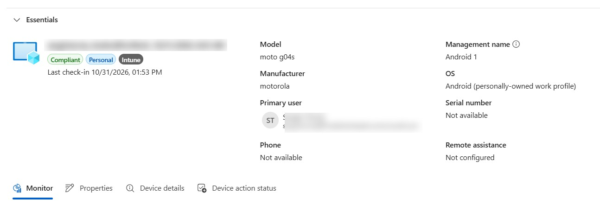

# Android Enterprise – Personally Owned Work Profile

<badge color="success">Implemented and validated</badge>

## Project Overview

This project demonstrates the enrollment of a personally owned Android device using Microsoft Intune and the Company Portal application.

The device was enrolled using the Android Enterprise Personally Owned Work Profile method, creating a separate managed work environment on the personal device.

## Lab Environment

| Component | Configuration |
|---|---|
| Platform | Android Enterprise |
| Device ownership | Personally Owned |
| Enrollment method | Company Portal |
| Management platform | Microsoft Intune |
| Management mode | Work Profile |

## Implementation

The Android device was enrolled through the Microsoft Company Portal application using the Personally Owned Work Profile enrollment method.

After enrollment, the device appeared in the Microsoft Intune admin center as a managed Android device.

## Validation

The enrollment was successfully completed.

The Intune device record confirms the personally owned device and its Android Enterprise Work Profile management mode.

## Evidence

### Android Device Enrollment in Microsoft Intune

*Screenshot captured from a personal Microsoft Intune lab tenant. Sensitive information has been redacted for privacy.*
