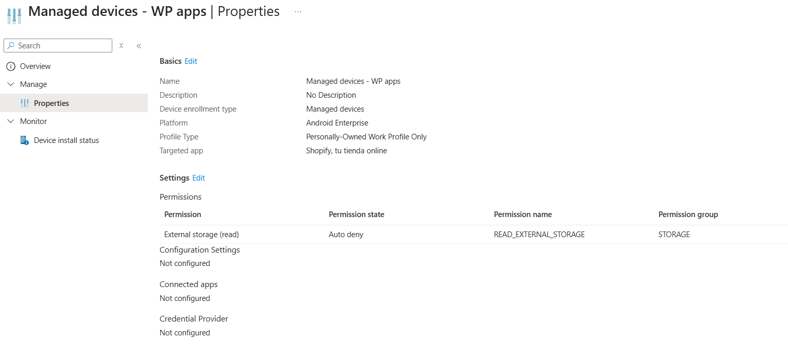
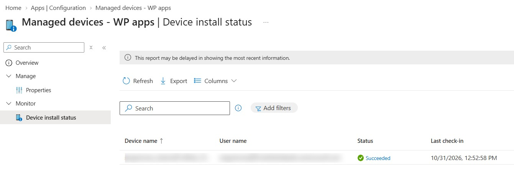

# Android Enterprise – Managed App Permissions

<badge color="success">Implemented and validated</badge>

## Project Overview

This project demonstrates application permission management for Android Enterprise personally owned Work Profile devices using Microsoft Intune.

The policy configures permission behavior for Shopify within the managed work profile.

## Lab Environment

| Component | Configuration |
|---|---|
| Platform | Android Enterprise |
| Enrollment type | Personally Owned Work Profile |
| Management | Microsoft Intune |
| Targeted application | Shopify |
| Policy type | Managed App Permissions |

## Configuration

The policy was created with the following configuration:

| Setting | Configuration |
|---|---|
| Targeted app | Shopify |
| Permission | External storage (read) |
| Permission state | Auto deny |
| Configuration settings | Not configured |
| Connected apps | Not configured |
| Credential Provider | Not configured |

The external storage read permission was configured to be automatically denied.

## Deployment and Validation

The policy deployment was monitored through the Microsoft Intune Device Install Status report.

Microsoft Intune reported a successful status (**Succeeded**).

## Evidence

### Managed App Permissions Configuration

### Device Installation Status

*Screenshots captured from a personal Microsoft Intune lab tenant. Sensitive information has been redacted for privacy.*
