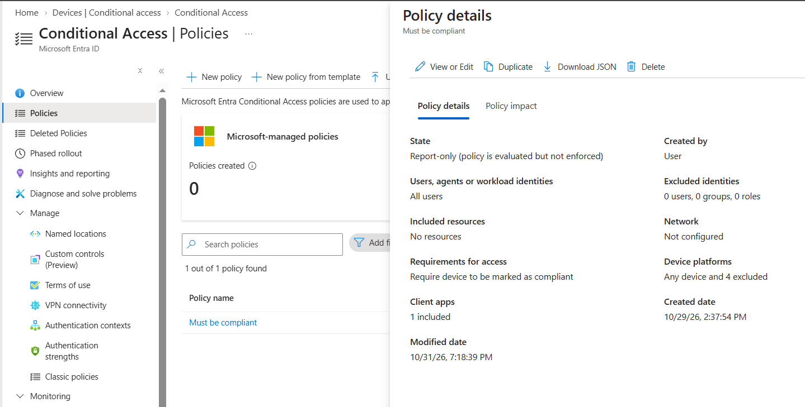

# Conditional Access – Require Compliant Device

## Project Overview

This lab demonstrates the creation of a Microsoft Entra Conditional Access policy designed to evaluate access based on device compliance.

The policy remains in **Report-only** mode, allowing its potential impact to be evaluated without enforcing access restrictions.

## Policy Configuration

| Setting | Configuration |
|---|---|
| Policy name | Must be compliant |
| Users | All users |
| Excluded users | None |
| Target resources | No resources selected |
| Grant control | Require device to be marked as compliant |
| Device platforms | Any device, with 4 exclusions |
| Network | Not configured |
| Client apps | 1 included |
| Policy state | Report-only |

## Access Control

The configured grant control requires devices to be marked as compliant.

In Report-only mode, Microsoft Entra evaluates policy conditions during sign-in without enforcing the access control requirement.

## Validation and Current Status

The policy configuration confirms:

- Report-only mode is enabled.
- All users are included, with no exclusions.
- The compliant-device grant control is selected.
- No target resources are currently selected.

**Current status:** Initial lab configuration. The policy is not fully scoped because no target resources have been selected.

## Evidence

### Conditional Access Policy Configuration

*Screenshot captured from a personal Microsoft Entra lab tenant. Sensitive information has been redacted for privacy.*
