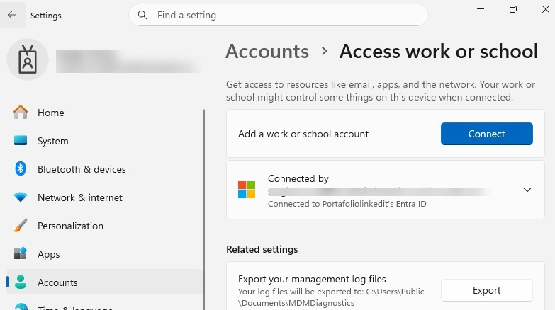
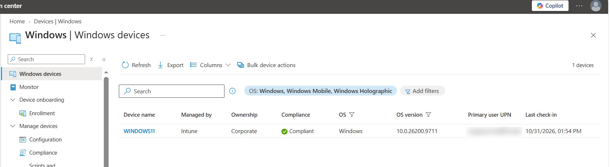

# Windows 11 Device Enrollment and Management

<badge color="success">Implemented and validated</badge>

## Project Overview

This project demonstrates the enrollment and management of a Windows 11 virtual machine through Microsoft Intune.

The device was connected to an organizational account and enrolled for management, allowing its inventory and compliance status to be monitored from the Intune admin center.

## Lab Environment

| Component | Configuration |
|---|---|
| Platform | Windows 11 |
| Management | Microsoft Intune |
| Device | WINDOWS11 |
| Virtualization | VirtualBox |
| Manufacturer | innotek GmbH |
| Model | VirtualBox |
| Ownership | Corporate |
| Management authority | Intune |

## Implementation

### Device Enrollment

The Windows 11 virtual machine was connected to the organizational account through Windows Settings and enrolled for management using Microsoft Intune.

### Device Management

The enrolled device was located in the Intune admin center under:

`Devices → Windows → Windows devices`

The device record confirmed its name, hardware information, corporate ownership, and Intune management status.

### Compliance Validation

Microsoft Intune reported the device compliance status as:

<badge color="success">Compliant</badge>

This confirms that the device was reported as compliant at the time of validation.

## Evidence

### Windows 11 Organizational Account Connection

### Windows 11 Device Overview in Microsoft Intune

*Screenshots captured from a personal Microsoft Intune lab tenant. Sensitive information has been redacted for privacy.*
