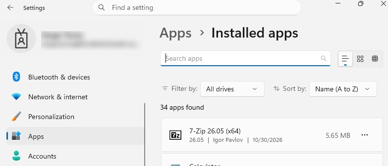
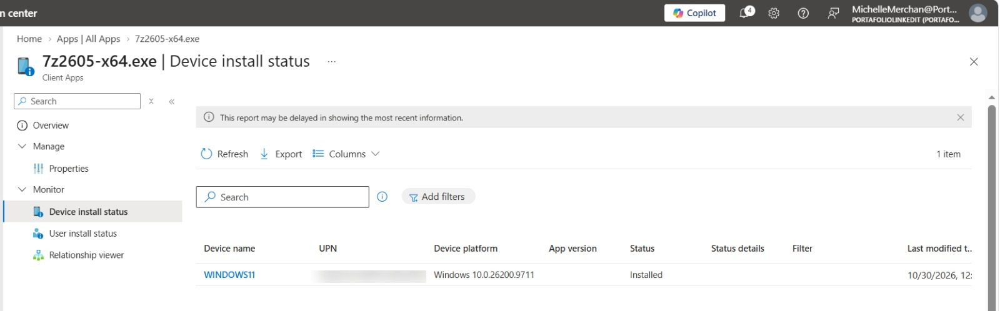

# Win32 Application Deployment with Microsoft Intune

<badge color="success">Implemented and validated</badge>

## Project Overview

This project demonstrates the packaging and deployment of a Win32 application using Microsoft Intune.

The application selected was **7-Zip x64**, packaged into the `.intunewin` format using Microsoft's Win32 Content Prep Tool.

## Lab Environment

| Component | Configuration |
|---|---|
| Management | Microsoft Intune |
| Platform | Windows 11 |
| Device | WINDOWS11 Virtual Machine |
| Application | 7-Zip x64 |
| Deployment type | Win32 |
| Installation context | System |
| Assignment | Windows device group |

## Implementation

### 1. Application Packaging

The original 7-Zip x64 installer was packaged using Microsoft's Win32 Content Prep Tool.

**Output package:** `7z2605-x64.intunewin`

### 2. Application Configuration

The application was uploaded to Microsoft Intune as a Windows app (Win32).

| Setting | Configuration |
|---|---|
| Installation command | `7z2605-x64.exe /S` |
| Installation behavior | System |
| Target architecture | 64-bit |
| Minimum operating system | Windows 10 version 1607 |

### 3. Detection Rule

A file-based detection rule was configured:

| Setting | Configuration |
|---|---|
| Rule type | File |
| Path | `C:\Program Files\7-Zip` |
| File | `7z.exe` |
| Detection method | File or folder exists |

### 4. Application Assignment

The Win32 application was assigned to the Windows device group.

The target virtual machine synchronized with Microsoft Intune to receive the deployment.

## Validation and Results

The installation was verified on the Windows 11 virtual machine.

Microsoft Intune deployment reporting was also reviewed to monitor the application installation status.

## Evidence

### 7-Zip Installation on Windows 11

### Microsoft Intune Deployment Status

*Screenshots captured from a personal Microsoft Intune lab tenant. Sensitive information has been redacted for privacy.*
