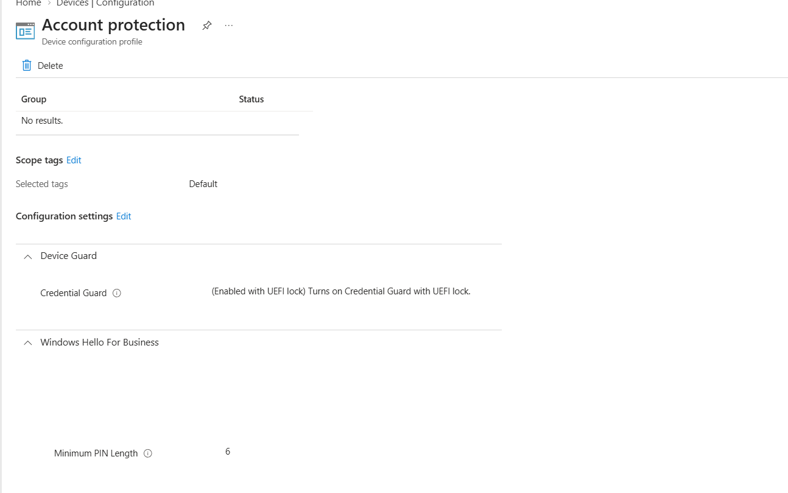
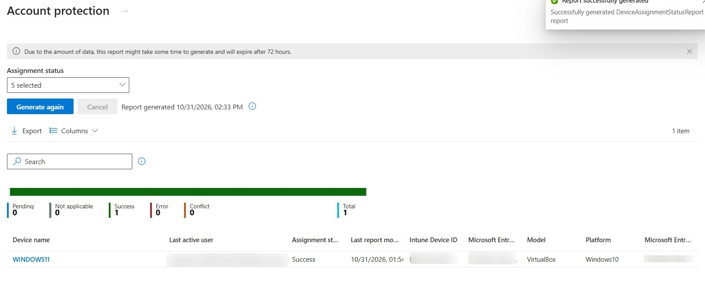

# Windows Account Protection

<badge color="success">Implemented and validated</badge>

## Project Overview

This project demonstrates the configuration of Windows Account Protection settings using Microsoft Intune on a Windows 11 virtual machine.

## Environment

| Component | Configuration |
|---|---|
| Platform | Windows 11 |
| Management | Microsoft Intune |
| Device | Windows 11 Virtual Machine |
| Policy type | Account Protection |
| Scope tag | Default |

## Configuration

### Device Guard

| Setting | Configuration |
|---|---|
| Credential Guard | Enabled with UEFI Lock |

### Windows Hello for Business

| Setting | Configuration |
|---|---|
| Minimum PIN Length | 6 characters |

## Deployment and Validation

The Intune assignment status report showed the following results:

| Status | Devices |
|---|---:|
| Success | 1 |
| Pending | 0 |
| Error | 0 |
| Conflict | 0 |
| Not applicable | 0 |

The policy was successfully applied to the Windows 11 lab device.

## Evidence

### Account Protection Configuration

### Assignment Status

*Screenshots captured from a personal Microsoft Intune lab tenant. Sensitive information has been redacted for privacy.*
