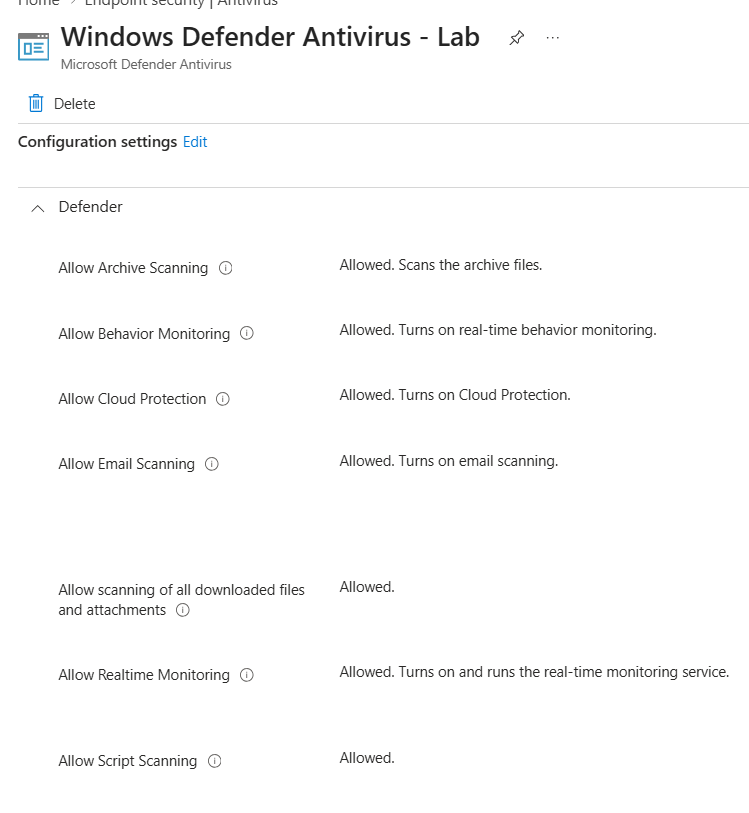
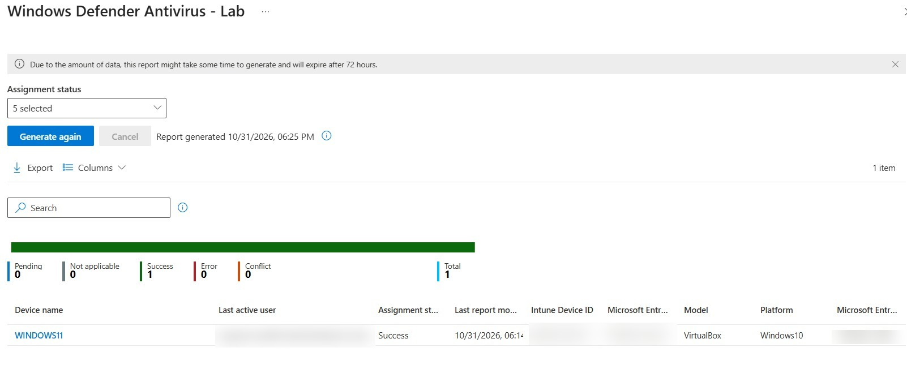

# Microsoft Defender Antivirus Management

<badge color="success">Implemented and validated</badge>

## Project Overview

Configuration and deployment of Microsoft Defender Antivirus policies through Microsoft Intune on a Windows 11 Enterprise virtual machine.

## Environment

| Component | Configuration |
|---|---|
| Platform | Windows 11 Enterprise |
| Management | Microsoft Intune |
| Device | Windows 11 Virtual Machine |
| Policy name | Windows Defender Antivirus - Lab |
| Policy type | Endpoint Security - Antivirus |
| Assignment | Windows devices |

## Security Configuration

The following Microsoft Defender Antivirus settings were configured:

| Security Setting | Applied Value |
|---|---|
| Archive Scanning | Allowed |
| Behavior Monitoring | Allowed |
| Cloud Protection | Allowed |
| Email Scanning | Allowed |
| Downloaded Files and Attachments Scanning | Allowed |
| Real-time Monitoring | Allowed |
| Script Scanning | Allowed |
| Network Protection | Enabled |
| Potentially Unwanted Applications (PUA) Protection | Enabled |

## Deployment Results

The policy was assigned to the Windows devices group through Microsoft Intune.

**Deployment Status: Succeeded**

| Status | Devices |
|---|---:|
| Successful | 1 |
| Pending | 0 |
| Error | 0 |

## Evidence

### Microsoft Defender Antivirus Configuration

### Policy Deployment Status

*Screenshots captured from a personal Microsoft Intune lab tenant. Sensitive information has been redacted for privacy.*