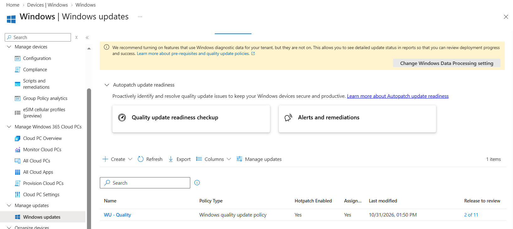
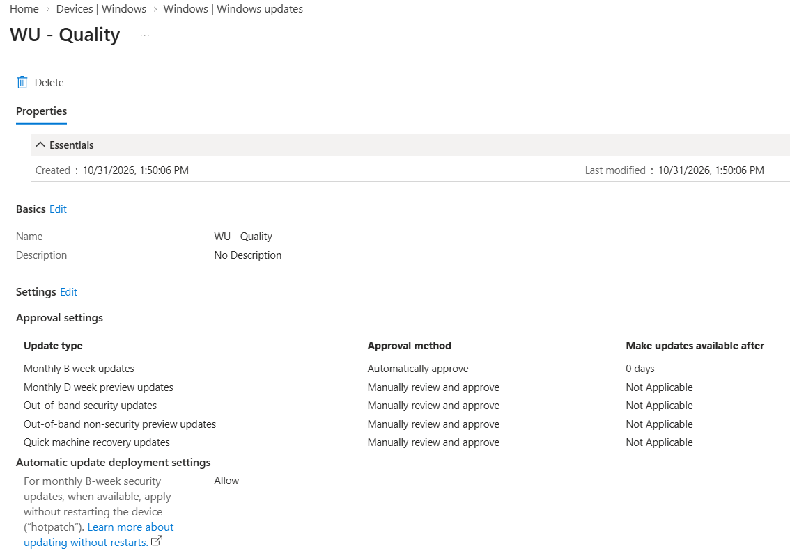
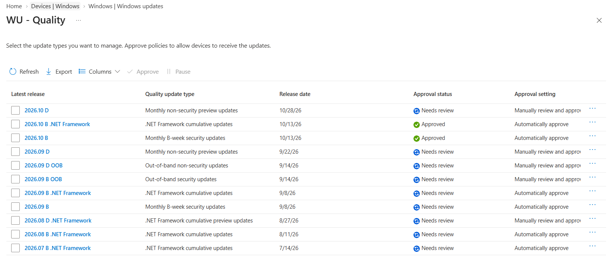

# Windows Quality Update Policy

<badge color="success">Implemented and validated</badge>

## Project Overview

This project demonstrates the configuration and management of a Windows Quality Update policy using Microsoft Intune.

## Environment

| Component | Configuration |
|---|---|
| Platform | Windows 11 Enterprise |
| Management | Microsoft Intune |
| Device | Windows 11 Virtual Machine |
| Policy name | WU - Quality |
| Policy type | Windows Quality Update Policy |
| Assignment | Windows devices |

## Configuration

The policy was configured with the following approval settings:

| Update Type | Approval Method |
|---|---|
| Monthly B-week updates | Automatically approve |
| Monthly D-week preview updates | Manually review and approve |
| Out-of-band security updates | Manually review and approve |
| Out-of-band non-security updates | Manually review and approve |
| Quick machine recovery updates | Manually review and approve |

### Hotpatch Configuration

Automatic update deployment was enabled for monthly B-week security updates, allowing supported updates to be applied without restarting the device when available.

## Deployment and Validation

The policy was assigned to the Windows devices group.

Microsoft Intune reported the following assignment results:

| Status | Devices |
|---|---:|
| Success | 1 |
| Pending | 0 |
| Error | 0 |

The update release dashboard showed two approved releases and additional releases requiring review.

Manual approval settings were retained for preview and out-of-band updates.

## Evidence

### Quality Update Policy Overview

### Policy Configuration and Approval Settings

### Update Release Approval Status

*Screenshots captured from a personal Microsoft Intune lab tenant. Sensitive information has been redacted for privacy.*
