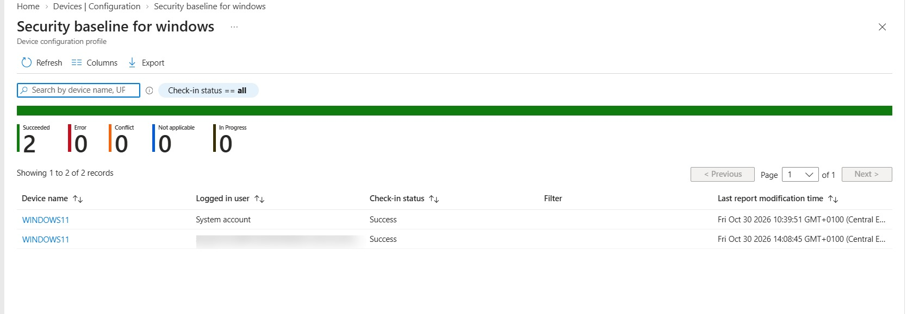

# Windows Security Baseline Deployment

<badge color="success">Implemented and validated</badge>

## Project Overview

Deployment and validation of a Microsoft Windows Security Baseline using Microsoft Intune on a Windows 11 virtual machine.

## Lab Environment

| Component | Configuration |
|---|---|
| Platform | Windows 11 |
| Management | Microsoft Intune |
| Policy | Security baseline for Windows |
| Assignment | Windows devices |
| Test device | Windows 11 Virtual Machine |

## Security Configuration

The Microsoft-recommended baseline configuration was applied, covering the following security areas:

- Microsoft Defender
- User Account Control (UAC)
- Local Security Authority (LSASS)
- Windows Firewall
- BitLocker
- SMB security
- Remote Desktop
- PowerShell logging
- Microsoft SmartScreen

## Deployment Results

The baseline was assigned to the Windows devices group.

| Deployment status | Records |
|---|---:|
| Successful | 2 |
| Errors | 0 |
| Conflicts | 0 |
| In progress | 0 |

**Validation note:** Both successful records correspond to the same virtual machine (`WINDOWS11`), reported under different accounts. They do not represent two separate devices.

## Evidence

### Microsoft Intune – Deployment Status

*Screenshot captured from a personal Microsoft Intune lab tenant. Sensitive information has been redacted for privacy.*