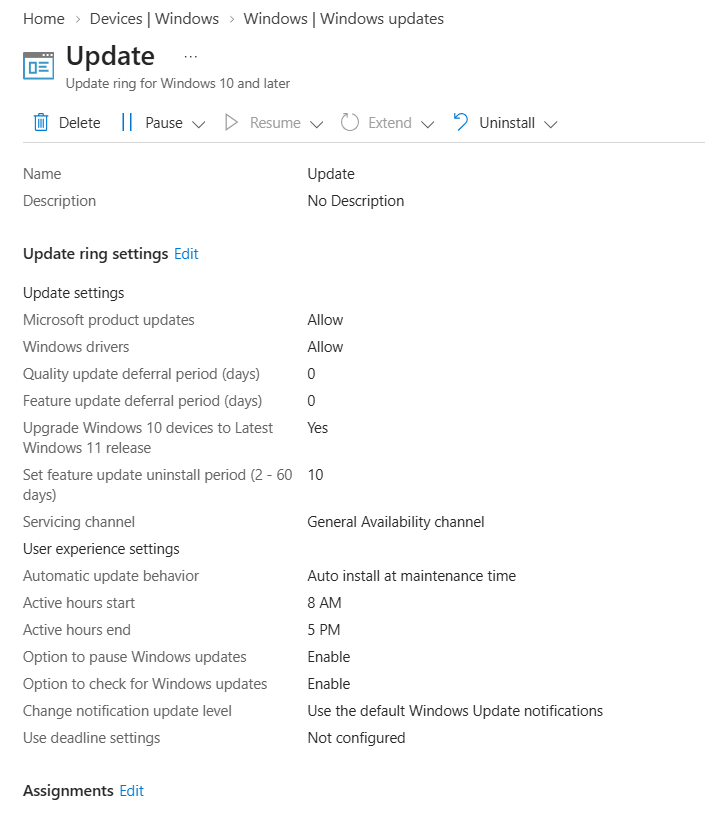
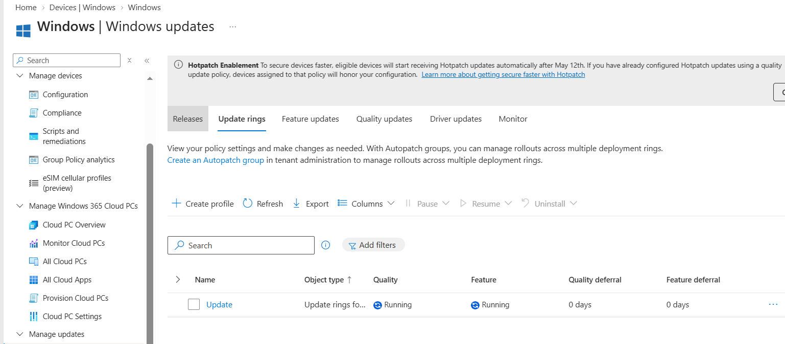
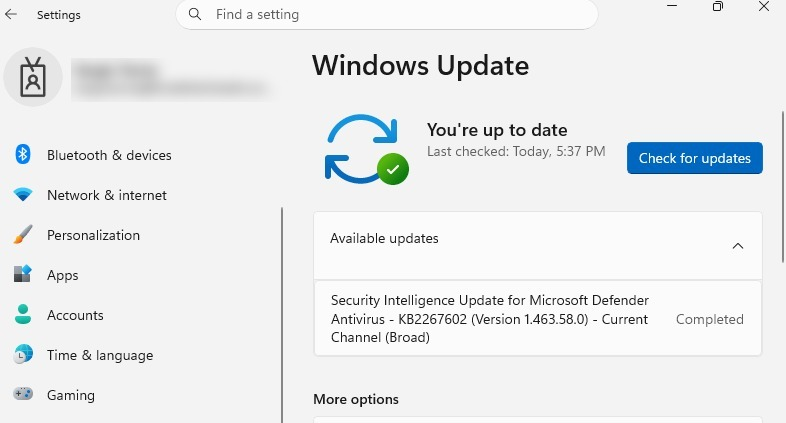

# Windows Update Ring Management

## Project Overview

This project demonstrates the configuration and monitoring of a Windows Update Ring policy using Microsoft Intune on a Windows 11 Enterprise virtual machine.

## Environment

| Component | Configuration |
|---|---|
| Platform | Windows 11 Enterprise |
| Management | Microsoft Intune |
| Device | Windows 11 Virtual Machine |
| Policy type | Windows Update Ring |
| Assignment | Windows devices |

## Configuration

The Windows Update Ring policy was configured in Microsoft Intune to manage Windows update behavior, including update installation and management settings.

## Deployment and Validation

The policy was assigned to the Windows devices group.

Microsoft Intune reported the policy status as **Running** for the target device, `WINDOWS11`.

During validation, Windows Update on the virtual machine reported that the device was up to date. An additional update download was also observed.

The Intune status is documented as reported and is not presented as a completed deployment.

## Evidence

### Update Ring Configuration

### Update Ring Deployment Status

### Windows Update on the Virtual Machine

*Screenshots captured from a personal Microsoft Intune lab tenant. Sensitive information has been redacted for privacy.*
